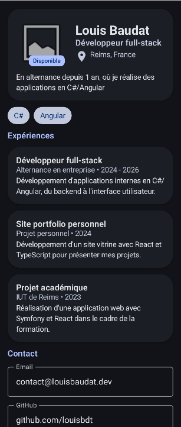

# Profil développeur Compose — v2

## Description
Application affichant la fiche d'un développeur : avatar avec badge de disponibilité, en-tête (nom, rôle, localisation), description, liste de compétences, liste d'expériences/projets et zone de contact. Version améliorée du premier devoir, construite avec des listes modernes et un thème Material 3 clair/sombre.

## Composants Compose utilisés
- `Text` : titres, descriptions, informations
- `Button` : action principale ("Voir mon GitHub")
- `Icon` : icône de localisation à côté de la ville
- `Image` : avatar placeholder du développeur
- `Card` : en-tête (`ProfileHeaderCard`) et chaque expérience (`ExperienceCard`)
- `OutlinedTextField` (lecture seule) : email, lien GitHub, disponibilité
- `Surface` : badge de disponibilité, `SkillChip`

## Layouts utilisés
- `Column` : structure verticale des cartes et sections
- `Row` : avatar + informations côte à côte, icône + texte de localisation
- `Box` : badge superposé sur l'avatar
- `Spacer` : espacement entre les éléments
- `Surface` : zones visuelles cohérentes avec le thème

## Liste affichée avec LazyColumn / LazyRow
- `LazyRow` pour les compétences, chacune affichée par le composable réutilisable `SkillChip`.
- `LazyColumn` comme conteneur principal de l'écran : `item { }` pour les sections (en-tête, compétences, contact...) et `items(experiences) { }` pour afficher chaque expérience via le composable réutilisable `ExperienceCard`.

## Choix de thème
`ColorScheme` personnalisé (clair/sombre), `Shapes` arrondies et `Typography` dédiée sont définis dans `Theme.kt`/`Type.kt` et appliqués à l'ensemble de l'écran plutôt que composant par composant. Deux previews (`ProfileCardLightPreview`, `ProfileCardDarkPreview`) forcent chacun des deux thèmes pour vérifier que les couleurs restent lisibles dans les deux cas.

## Captures d'écran
Thème clair et thème sombre :

## Notions du chapitre Compose UI réutilisées
Composants fondamentaux (`Text`, `Button`, `Icon`, `Image`, `Card`, `OutlinedTextField`), layouts (`Column`, `Row`, `Box`, `Spacer`, `Surface`), listes modernes (`LazyRow`, `LazyColumn` avec des composables réutilisables) et Material Design 3 (`ColorScheme`, `Shapes`, `Typography`, thème clair/sombre).
