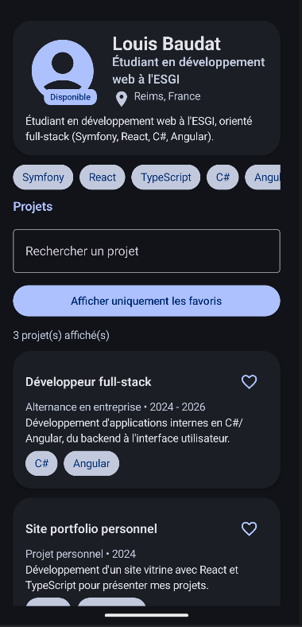
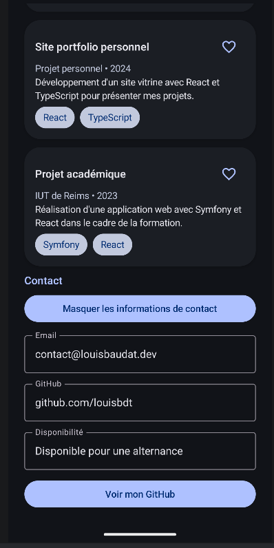

# Profil développeur interactif

## Description de l'application
Application affichant la fiche d'un développeur (avatar, en-tête, description, compétences) sous forme de petit portfolio interactif. L'utilisateur peut rechercher un projet par titre, technologie ou description, marquer des projets comme favoris, n'afficher que ses favoris, voir le nombre de projets actuellement visibles, et afficher/masquer les informations de contact. Un bouton permet aussi d'ouvrir le profil GitHub du développeur.

## États gérés par l'application
Gérés par `ProfileViewModel` (dans `ProfileUiState`) :
- texte de recherche (`searchQuery`)
- filtre « favoris uniquement » (`showOnlyFavorites`)
- identifiants des projets favoris (`favoriteProjectIds`)
- liste des projets actuellement affichée (`projects`), recalculée à chaque action

Géré localement dans un composable (hors ViewModel) :
- visibilité des informations de contact (`showContactInfo` dans `ContactSection`)

## État local
*Quel état avez-vous conservé directement dans un composable et pourquoi ?*

La visibilité des informations de contact est gérée dans `ContactSection` avec `rememberSaveable`. C'est un détail d'affichage propre à ce composable, qui n'a pas besoin d'être connu ailleurs dans l'application.

## State Hoisting
*Pourquoi votre composable d'écran principal peut-il être considéré comme stateless ?*

`ProfileScreen` ne contient aucun `remember` ni `mutableStateOf` pour son état principal : il reçoit ses données en paramètres et les actions utilisateur en callbacks. C'est `ProfileContainer` qui lui fournit cet état, en le récupérant depuis le ViewModel.

## ViewModel
*Quel est le rôle de votre ViewModel dans cette application ?*

`ProfileViewModel` gère l'état principal de l'écran : il garde la liste des projets, applique la recherche et le filtre favoris, et expose des fonctions que l'UI appelle en réaction aux actions de l'utilisateur.

## StateFlow
*Comment l'interface est-elle informée lorsqu'un état change ?*

Le ViewModel expose son état via un `StateFlow`. `ProfileContainer` le collecte avec `collectAsState()`, ce qui déclenche automatiquement la recomposition de l'interface à chaque nouvel état publié.

## Organisation du code
- `ProfileModels.kt` : `ProjectUi` (données d'un projet) et `sampleProjects()` (données locales)
- `ProfileViewModel.kt` : `ProfileUiState` (état de l'écran) et `ProfileViewModel` (StateFlow, recherche, filtre, favoris)
- `ProfileComponents.kt` : composants réutilisables (`ProfileAvatar`, `ProfileHeader`, `ProfileHeaderCard`, `SkillChip`, `SkillsRow`, `ProjectCard`, `ContactSection`, `ContactButton`)
- `ProfileScreen.kt` : `ProfileContainer` (récupère le ViewModel, collecte le StateFlow) et `ProfileScreen` (écran stateless), ainsi que les previews
- `MainActivity.kt` : lance l'écran et ouvre le lien GitHub via une `Intent`

## Captures d'écran

